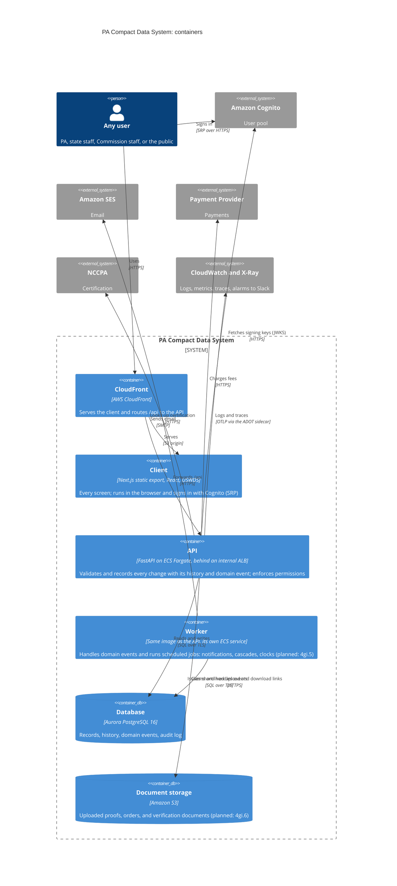

# Architecture (C4)

The system's context and containers, in the [C4 model](https://c4model.com/).
Elements marked _planned_ are designed but not built yet; each names the
ticket that builds it. Update these diagrams in the pull request that changes
what they show.

## Context

Who uses the PA Compact Data System, and which outside systems it depends on.

```mermaid
---
title: "PA Compact Data System: system context"
---
flowchart TD
  pa@{shape: person, label: "Physician's Assistant"}
  state@{shape: person, label: "State staff"}
  commission@{shape: person, label: "Commission staff"}
  public@{shape: person, label: "Public and employers"}

  cds["PA Compact Data System"]

  cognito["Amazon Cognito"]
  ses["Amazon SES"]
  payments["Payment Provider"]
  nccpa["NCCPA"]
  boards@{shape: terminal, label: "State licensing systems"}

  pa paToCds@-- "Apply for privileges<br/>Pay fees<br/>Manage profile" --> cds
  state stateToCds@-- "Verify eligibility<br/>Issue or deny privileges<br/>Report adverse actions<br/>Configure state" --> cds
  commission commissionToCds@-- "Read reports and audits<br/>Override privileges<br/>Configure the compact" --> cds
  public publicToCds@-- "Verify PA privileges" --> cds
  boards boardsToCds@-- "Send licensee data" --> cds
  cds -- "Authenticate PAs, State staff, and Commission staff" --> cognito
  cds cdsToSes@-- "Send notification emails" --> ses
  cds cdsToPayments@-- "Collect payments" --> payments
  cds cdsToNccpa@-- "Query PA national certifications" --> nccpa

  classDef person fill:#08427b,stroke:#073b6f,color:#fff
  classDef system fill:#1168bd,stroke:#0b4884,color:#fff
  classDef machine_user fill:#0A559F,stroke:#073b6f,color:#fff
  class pa,state,commission,public,boards person
  class cds system
```

## Containers

What runs inside the system, all in AWS `us-east-1` (SOW §2: Commission data
stays in the United States).



## Locally

Every external service above has a local stand-in that the app reaches
through its production client; only URLs differ (constitution Principle IV).
See [Run the whole system locally](../../README.md#run-the-whole-system-locally)
and [`engineering/api/.env.example`](../api/.env.example).

| In AWS | Locally |
|---|---|
| Aurora PostgreSQL | Postgres in Docker Compose |
| Cognito | cognito-local ([`engineering/mocks/cognito`](../mocks/cognito/README.md)), signed in to with password auth instead of SRP ([ADR-0010](../adrs/0010-local-sign-in-uses-password-auth.md)) |
| SES | maildev |
| S3 | RustFS |
| Payment Provider, NCCPA | Mock servers, built with the tickets that write their clients |
