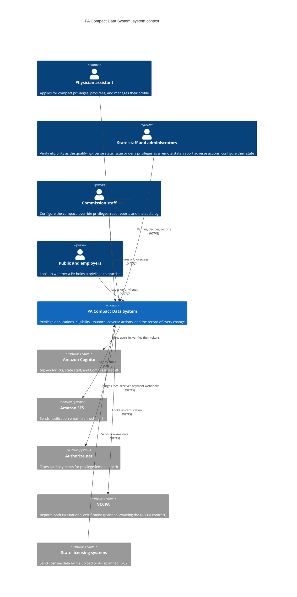

# Architecture (C4)

The system's context and containers, in the [C4 model](https://c4model.com/).
Elements marked _planned_ are designed but not built yet; each names the
ticket that builds it. Update these diagrams in the pull request that changes
what they show.

## Context

Who uses the PA Compact Data System, and which outside systems it depends on.

## Containers

What runs inside the system, all in AWS `us-east-1` (SOW §2: Commission data
stays in the United States).

## Locally

Every external service above has a local stand-in that the app reaches
through its production client; only URLs differ (constitution Principle IV).
See [Run the whole system locally](../../README.md#run-the-whole-system-locally)
and [`engineering/api/.env.example`](../api/.env.example).

| In AWS | Locally |
|---|---|
| Aurora PostgreSQL | Postgres in Docker Compose |
| Cognito | The Cognito mock ([`engineering/mocks/cognito`](../mocks/cognito/README.md)) |
| SES | maildev |
| S3 | RustFS |
| Authorize.net, NCCPA | Mock servers, built with the tickets that write their clients |
