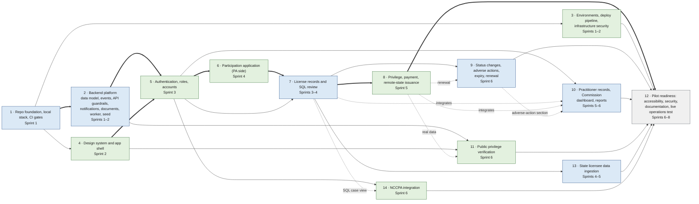

# Epic Dependencies

What blocks what among the fourteen epics in [`mvp-jira-tickets.md`](mvp-jira-tickets.md), from each engineering ticket's **Blocked by** line. The ticket text governs; this diagram is a view of it.

## Reading it

| Mark | Meaning |
|---|---|
| Thick arrow | The critical path to the Sprint 5 milestone, a privilege issued end to end in production on test data |
| Solid arrow | **Blocked by**: the epic cannot start, or a named part of it cannot start, until the other merges |
| Dotted arrow | The epic starts against the demo seed (epic 2) or its own stub, and integrates when the other lands |
| Blue | Tech lead: platform, and the state and Commission journey |
| Green | Fullstack engineer: the PA journey, the public site, and the design system |
| Grey | Both (epic 12 splits security and the live test from accessibility and documentation) |

## What the arrows leave out

- **Partial starts.** Epic 7's configuration and license records start in Sprint 3 on epic 5 alone; only its SQL review waits on epic 6. Epic 13 needs only epic 7's license-record half.
- **Epic 14 is blocked only by epic 5.** Its dotted arrow from epic 7 is the SQL case view it shows the NCCPA value on, which it consumes but does not wait for.
- **Consumes without blocking.** Every epic consumes epic 2's helpers and epic 4's primitives once they exist, and epic 11 uses epic 3's WAF rate limit. These are listed under **Consumes** in each ticket, not drawn.
- **The base data model.** F-02 (part of epic 2) lands every table the verticals share, so epics 6–14 can begin their data and API work as soon as it merges; see [`engineering/docs/data-model.md`](../../engineering/docs/data-model.md).
