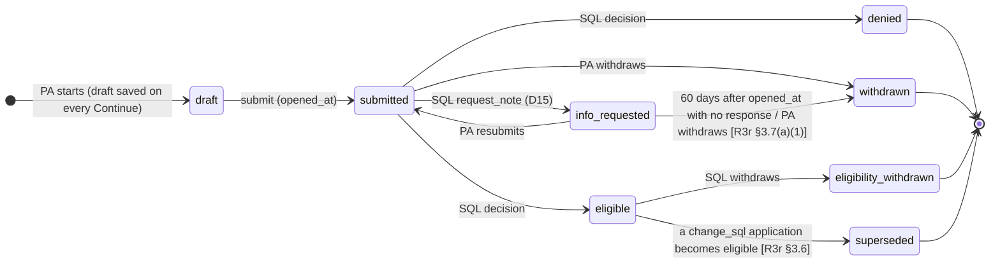
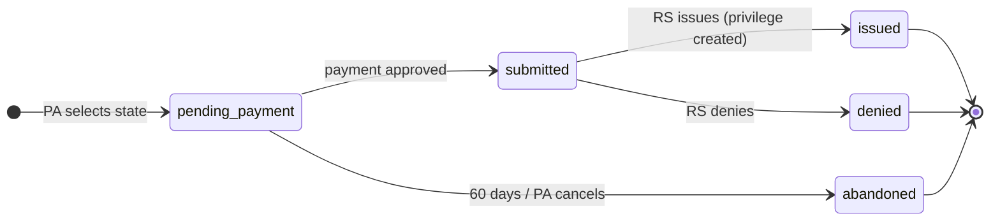
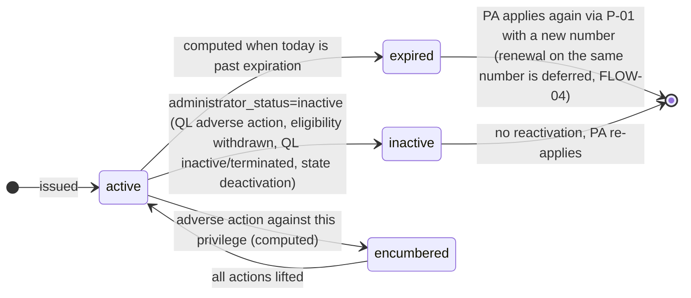

> **Needs review (2026-10-01, SCRUM-39).** This file cites two atoms that quoted draft rule text. That text changed when Rules 3 and 4 were adopted on 2026-04-06. `ATOM-GOV-R23-13` is replaced by `ATOM-GOV-R3-04`; `ATOM-GOV-R23-15` is replaced by `ATOM-GOV-R3-06`. The draft and adopted text are side by side in `product/context/evidence/CHANGES-2026-10-01-adopted-rules.md`.  Added 2026-10-02 (SCRUM-39): `ATOM-GOV-R23-09` is replaced by `ATOM-GOV-R3-07`. The adopted Rule 3.5(a) adds "or the qualifying license is voluntarily terminated by the PA" and "in accordance with Section 4.A of the model legislation". See the change index. Added 2026-10-02 (SCRUM-39): `ATOM-GOV-R23-11` quotes draft text the adopted rules left out (privileges staying active after the license's expiry date), and has no replacement. See the change index and `TENSION-03`. Remove this note when the file is updated.

# FLOW-06 — State machines

Stored statuses are the ones a person or a rule sets. Privilege *status* is a computed view (decision D1): `active` only if `administrator_status=active`, today ≤ `expiration_date`, and no unlifted adverse action against it. This is CompactConnect's rule too (crosswalk §7 item 5: "status is derived, never edited by hand"); the difference is that we compute it on read where CompactConnect stores and re-derives it.

## Participation application (L-03 / L-05 / L-06)

The 60-day withdrawal applies only when the PA has not answered the SQL's request for information (Open Question 35, decided 2026-11-16). A `submitted` application is waiting on the SQL, so it never times out. The clock starts when the SQL receives the application (`opened_at`, R3r §3.7(a)).

A draft never expires and the PA can keep editing it: the SQL has not received it, so no clock runs.

- **One open application.** A PA with an application in `draft`, `submitted`, or `info_requested` continues it rather than starting another.
- **No new application once eligible.** Changing the state of qualifying license (`change_sql`) is not in v1: approving one ends the PA's privileges (R3r §3.6(d)) and the rules for it are incomplete (TENSION-02). The PA is told to contact PA Compact instead.
- **Editing.** The PA edits the application and accepts attestations only while it is `draft` or `info_requested`, and changes the state of qualifying license only in a draft.
- **History starts when the SQL receives it.** Starting and saving a draft, and the PA's edits while `info_requested`, record no history. Each submit and resubmit records the whole application as sent, so history keeps every version the SQL saw.
- **Documents attach at submit.** Each must be the PA's own unattached upload whose malware scan came back clean; one still being scanned waits.

`tests/test_application_transitions.py` keeps this diagram equal to `APPLICATION_TRANSITIONS`.

## Privilege request (P-01 / P-03)

There is no `info_requested` on a privilege request at pilot: a remote state with a question contacts the PA from the case view (D15). Deferred (§5.1): `info_requested` returns with the case message thread; if ACH is enabled (Q-02c), `pending_payment` gains a `submitted_payment_pending` successor and issuance is gated on settlement.

## Privilege (computed status view, never stored)

`deactivation_reason` enum: `qualifying_license_adverse_action | eligibility_withdrawn | qualifying_license_inactive | qualifying_license_terminated | state_deactivated`.

The status vocabulary shown to the PA and the public follows CompactConnect's privilege card and history: "Active (Expires: date)", "Inactive (Expired: date)", "Inactive (Deactivated)", and one event vocabulary for the timeline (issued, renewed, expired, deactivated, disciplinary action, disciplinary action lifted). CompactConnect's "Privilege purchased" becomes "Privilege issued" (crosswalk §3.4).

SOW §2.1 (redline response v2) has public verification cover active and inactive privileges, so the inactive statuses in this vocabulary are public as well as the active one; FLOW-05 says what the public view withholds. The public sees three statuses, `active`, `expired`, and `inactive`: an encumbered privilege shows as `inactive`, whether or not the action against it is public (decided 2026-11-16, SCRUM-139). Renewal on the same number is listed in SOW §2.1 but still deferred in the backlog (FLOW-04).

## Evidence

Atoms are in `product/context/evidence/atoms/`; signals and tensions beside them. Rule section references above resolve to these IDs.

- `ATOM-GOV-R23-13` — `withdrawn` / `abandoned` after 60 days
- `ATOM-GOV-R23-15` — `eligibility_withdrawn` → privileges cancelled
- `ATOM-GOV-ML-09`, `ATOM-GOV-R23-09`, `ATOM-GOV-R23-11` — why privilege status is computed from the QL and never stored
- `SIGNAL-privilege-life-is-tied-to-the-qualifying-license`
