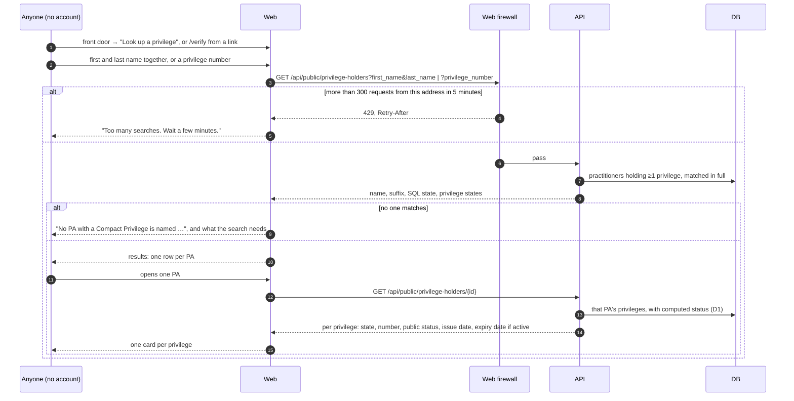

# FLOW-08 — Public verification

Anyone, with no account, confirms whether a PA holds a compact privilege in a state (SOW §2.1: "verify active and inactive PA compact privileges"). It is the only place the system shows data to someone who has not signed in, so what it shows is a closed list. Jira: SCRUM-137 (this step), SCRUM-139 (the build).

## What the public sees

| Shown | Why it is public |
|---|---|
| First name, last name, suffix | R4 §4.5(b)(1): the names of participating PAs |
| State of qualifying license; each privilege's state | R4 §4.5(b)(2) |
| Each privilege's number, status, and issue date; its expiry date while it is active | Q-12 default, taken as the answer on 2026-11-16. These are the four fields the remote state submits (R4 §4.3(d)(1)) |

Nothing else: no middle or other names, date of birth, NPI, contact details, license number or status, compact eligibility, history, or anything about an adverse action or investigation. CompactConnect shows NPI, eligibility, and discipline dates (crosswalk §6); we do not.

## Invariants

- **Three public statuses.** `active`, `expired`, `inactive`. FLOW-06's `encumbered` shows as `inactive` whether or not the action behind it is public: if only the non-public ones were collapsed, the status would tell the two apart. R4 §4.5(c) seals adverse-action reports except publicly available ones, and R4 §4.5(d) (ML §8.E) lets a state mark information not to be shared with the public; showing neither kind is stricter than both.
- **Never why.** A privilege that is not active carries no reason and no date of the change (FLOW-05).
- **An expiry date only while active.** An `expired` or `inactive` privilege carries none. A date still ahead beside `inactive` would show the privilege was ended early, which is most of the way to saying it is encumbered. Decided 2026-11-17 in review of SCRUM-139; it answers Q-31.
- **Two searches, no others.** Both names in full, ignoring letter case and surrounding spaces, or one exact privilege number. No partial names, no search by state alone, no NPI, so the register cannot be listed a letter at a time.
- **Only privilege holders are found.** A PA with no privilege, active or not, does not appear. An unknown PA and a PA with no privilege get the same answer.
- **Same name, both shown.** The suffix and the states tell two PAs apart; nothing private is added to do it.
- **Rate limit.** One address gets 300 requests in five minutes. Privilege numbers run in sequence within a state, so the limit is what paces a walk through them; everything such a walk returns is public by rule.
- **Read-only.** No write, event, or notification; the PA is not told they were looked up.
- **Search terms are not in the API's log.** It records a search's kind and result count. The terms are in the query string, so the CloudFront, firewall, and load-balancer access logs hold them beside the caller's address.

## Screens

Wireframes are block V on the [board](https://www.figma.com/design/k1W9PxXhtQ3fopcKUePpH9/PA-Compact-Parts-Library?node-id=5121-15647); the swimlane version of this flow is the [Flow: public lookup](https://www.figma.com/design/k1W9PxXhtQ3fopcKUePpH9/PA-Compact-Parts-Library?node-id=5123-16429) page. All are DRAFT until the Commission's Product Manager approves them.

| Frame | Shows |
|---|---|
| V0 · Front door ([`5126:16369`](https://www.figma.com/design/k1W9PxXhtQ3fopcKUePpH9/PA-Compact-Parts-Library?node-id=5126-16369)) | The page at `/`: three cards, each a title, one line, and a button. The third opens V1 |
| V0s · Front door, signed in ([`5126:16573`](https://www.figma.com/design/k1W9PxXhtQ3fopcKUePpH9/PA-Compact-Parts-Library?node-id=5126-16573)) | The same page with a session: the visitor's own card goes to their dashboard |
| V1 · Search by name ([`5121:15650`](https://www.figma.com/design/k1W9PxXhtQ3fopcKUePpH9/PA-Compact-Parts-Library?node-id=5121-15650)) | A radio pair picks the search; first and last name, both required |
| V1n · Search by number ([`5121:15809`](https://www.figma.com/design/k1W9PxXhtQ3fopcKUePpH9/PA-Compact-Parts-Library?node-id=5121-15809)) | One required field, with the number's format as its hint |
| V2 · Results ([`5122:15865`](https://www.figma.com/design/k1W9PxXhtQ3fopcKUePpH9/PA-Compact-Parts-Library?node-id=5122-15865)) | The search stays above a count and a table; the name opens the PA's page |
| V2e · No match ([`5122:16055`](https://www.figma.com/design/k1W9PxXhtQ3fopcKUePpH9/PA-Compact-Parts-Library?node-id=5122-16055)) | Says what the search needs, since a misspelling and a PA with no privilege look the same |
| V2x · Too many searches ([`5122:16217`](https://www.figma.com/design/k1W9PxXhtQ3fopcKUePpH9/PA-Compact-Parts-Library?node-id=5122-16217)) | A warning alert above the search, which stays filled in |
| V3 · A PA's page ([`5122:16336`](https://www.figma.com/design/k1W9PxXhtQ3fopcKUePpH9/PA-Compact-Parts-Library?node-id=5122-16336)) | Name, state of qualifying license, one card per privilege. No history |
| V3i · Not active ([`5122:16450`](https://www.figma.com/design/k1W9PxXhtQ3fopcKUePpH9/PA-Compact-Parts-Library?node-id=5122-16450)) | An expired card with its date; an inactive card with the tag alone. The expired card's date is as first drawn: the API no longer returns it |

Not drawn: pagination under the results table, the "We couldn't find that PA" page for an unknown address, and the front door at phone width, where the cards stack in order.

The front door is the backlog's three entries (epics 4 and 5), with the search on its own page. V0 is the designed version of A2 ([`3489:31409`](https://www.figma.com/design/k1W9PxXhtQ3fopcKUePpH9/PA-Compact-Parts-Library?node-id=3489-31409)), which stays on the board as first drawn. It replaces the two-column home page in the first SCRUM-139 plan (2026-11-16).

## Open questions

- **Q-32.** Whether the public word is "look up" or "verify". The screens say "Look up a Compact Privilege"; the SOW says verify.
- **Q-33.** Whether a search may match a PA's other names, such as a maiden name, or match loosely. Someone may know only a former name, and "the names of participating PAs" (R4 §4.5(b)(1)) may or may not cover the other names of R4 §4.3(c)(2). Until answered, the two searches above stand.

## Evidence

Atoms are in `product/context/evidence/atoms/`; the signal beside them.

- `ATOM-GOV-R5-06` — the two public exceptions: names, and the states of qualifying license and privilege (same wording adopted as R4 §4.5(b))
- `ATOM-GOV-R4-03` — the privilege fields a remote state submits: issue date, status, expiration date, number (R4 §4.3(d))
- `ATOM-GOV-ML-17` — statute: a state may designate information not to be shared with the public (ML §8.E; restated in R4 §4.5(d))
- `SIGNAL-disciplinary-data-is-confidential-by-default` (borderline)

Cited above with no atom yet: R4 §4.5(c), the seal on adverse-action and SII reports; SOW §2.1, "verify active and inactive PA compact privileges"; and the RFP's PA story that patients and the public can see every jurisdiction where the PA is privileged (RFP L77).
